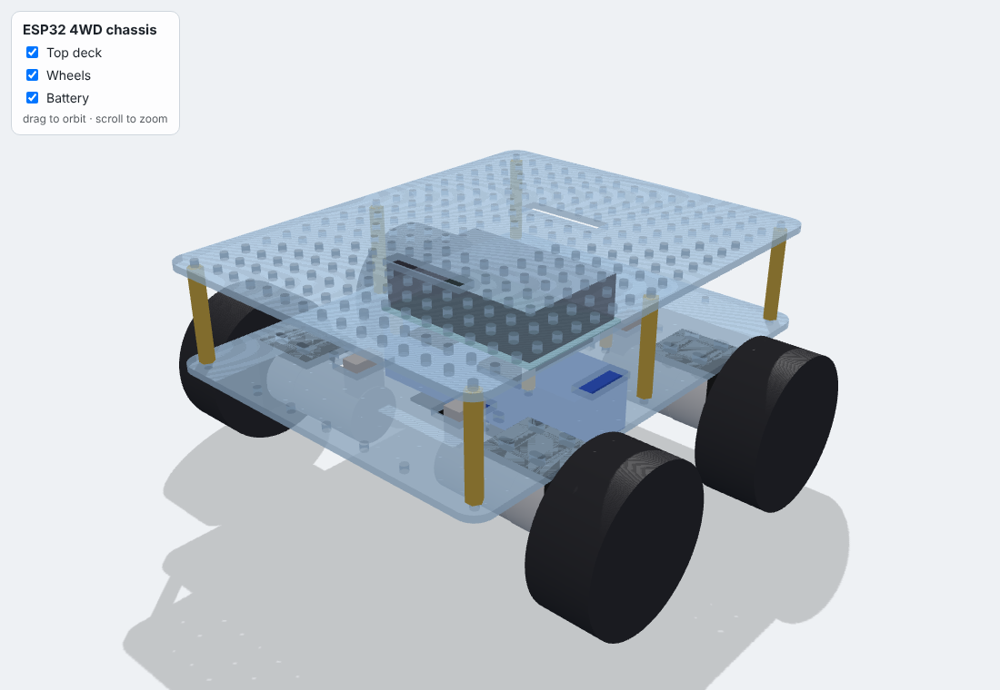

# ESP32 4WD Robot

Firmware for a four-wheel skid-steer robot built from:

- **NULLLAB Maker-ESP32 v1.7x**: ESP32-WROOM-32E with four onboard TB67H450FNG motor drivers
- **4 × JGA25-371 12 V ~500 RPM gearmotors** with 11-pulse Hall encoders and 65 mm wheels

You drive it from your phone's browser over Wi-Fi. Each wheel has closed-loop
speed control, so the robot drives straight and holds its speed on carpet,
on slopes and as the battery drains.

## Features

- **Wheel speed control at 100 Hz**: feed-forward plus PI with a reference
  model and anti-windup. Encoders are counted in the ESP32's pulse-counter
  hardware, so no pulses are missed even while Wi-Fi is busy.
- **Phone joystick**: a page with no external dependencies, served by the
  robot itself. Multi-touch safe, keyboard support (WASD / arrows), live
  per-wheel speed bars.
- **Safety**:
  - The robot must be **armed** before it moves, and only arms with the stick centred.
  - It stops by itself if the phone goes quiet (0.5 s) and disarms after 3 s.
  - **STOP** works from any connected device; only one device drives at a time.
  - **Stall detection** brakes all motors if a wheel is jammed.
  - **Battery protection** with a Holybro PM02 power module: voltage, current
    and charge used on the phone; a low battery caps speed, a flat one stops
    the robot and won't let it arm.
  - Acceleration and deceleration ramps mean the gearboxes never see an
    instant reversal, as the motor datasheet warns against.
- **Bring-up tool**: a serial wizard that works out which port drives which
  wheel, fixes motor and encoder directions, and measures counts per
  revolution, top speed and friction. It prints the exact config lines to paste.
- **Tested off-hardware**:
  - Host unit tests for the control logic, including a simulated motor.
  - A browser test of the web UI against a mock robot that uses the
    firmware's real message parser.
  - CI builds both firmwares on every push.

## 0. Build the chassis

A laser-cut, two-deck acrylic chassis designed for exactly these parts is in
**[hardware/chassis](hardware/chassis/README.md)**. The controller sits on the
lower deck between the motors (short wires), with the battery underneath for a
low centre of gravity. You get cut files (SVG for LightBurn, plus DXF), a
printable 1:1 check template, a 3D model, a parts list and assembly steps.



## 1. Wire it

See **[docs/WIRING.md](docs/WIRING.md)**. In short:

| Port | Wheel | Motor (red/white) | Encoder yellow (A) | Encoder green (B) |
|------|-------|-------------------|--------------------|-------------------|
| M1 | rear-left   | M1 terminal | GPIO 19 | GPIO 23 |
| M2 | front-left  | M2 terminal | GPIO 5  | GPIO 18 |
| M3 | rear-right  | M3 terminal | GPIO 33 | GPIO 32 |
| M4 | front-right | M4 terminal | GPIO 26 | GPIO 25 |

Power the encoders (blue = +, black = GND) from **3.3 V**. Measure it first,
because the docs disagree. Put the Motor/IO DIP switch on **Motor**, and
connect a 3S LiPo or 12 V pack to the DC jack.

The board can't measure battery voltage by itself, so put a **Holybro PM02**
power module in the battery lead and wire its VOLTAGE and CURRENT signals to
GPIO 34 and 35 ([details](docs/WIRING.md#5-battery-monitor-holybro-pm02-v3)).
Running a LiPo flat ruins it.

## 2. Install the tools

1. Install [VS Code](https://code.visualstudio.com/) and the **PlatformIO IDE** extension.
2. Install the [CH340 USB driver](https://www.wch-ic.com/downloads/CH341SER_ZIP.html)
   if your computer doesn't see the board (Windows/macOS).
3. Clone this repository and open the folder in VS Code. PlatformIO
   downloads the exact toolchain and library versions pinned in
   `platformio.ini` on the first build.

From a terminal the commands below work as shown. In VS Code use the
PlatformIO sidebar, which offers the same tasks for each environment (`robot`,
`bringup`).

## 3. Bring-up and calibration (do this once)

```sh
pio run -e bringup -t upload
pio device monitor          # 115200 baud; type `help`
```

Prop the robot up so the wheels spin freely, then run these in order:

| Command | What it does | Paste into `include/robot_config.h` |
|---|---|---|
| `enc` | Turn each wheel by hand; its count should change smoothly both ways | – |
| `dir` | Spins each port briefly. You answer which wheel turned and whether it went forward. It also detects swapped encoder cables. | the whole `kWheels` block |
| *(re-flash bring-up)* | so the next tests use the new directions | – |
| `cal` | Turn every wheel 10 times by hand | `kCountsPerWheelRev` |
| `maxspeed` | Full duty for 2 s | `kMaxWheelSpeedCps` |
| `friction` | Finds the duty where each wheel starts moving | `g.kS` |
| `step 0 50` | Closed-loop step test on all wheels, with a summary and CSV | gains, only if needed |
| `batt` | Live PM02 voltage and current; compare with a multimeter | – |
| `batt cal 12.34` | Calibrates the voltage scale to your meter reading | `kBatteryVoltsPerVolt` |

Any key aborts a running test. The default gains came from simulating these
motors, so `step` is mostly a check. To tune, run `gains <kp> <ki>` and repeat
`step` until the summary shows little overshoot and quick settling. Then copy
the printed line into `wheelGains()`.

## 4. Drive

```sh
pio run -e robot -t upload
pio device monitor          # shows the Wi-Fi name, password and address
```

1. On your phone, join Wi-Fi **`MakerBot-XXXX`**. The password is
   `makerbot123`; change `kApPassword` in `robot_config.h`.
2. Open **http://192.168.4.1**.
3. Press **ARM**, then drag the joystick. Use the speed slider to limit top
   speed; it starts at 50 %.

To use your home Wi-Fi instead, copy `include/wifi_secrets.example.h` to
`include/wifi_secrets.h` and fill it in. The robot then appears at
**http://makerbot.local**, or at the IP shown on the serial monitor. If it
can't connect, it falls back to its own network.

### Status LEDs

| Colour | Meaning |
|---|---|
| White | Starting up |
| Blue, breathing | Disarmed, nobody connected |
| Blue, solid | Disarmed, a phone is connected |
| Green | **Armed**: the robot will move |
| Yellow, blinking | Armed but the phone link dropped; the robot is stopping |
| Red, blinking | Fault (stalled wheel or hardware error); press RESET in the app |
| Amber | Disarmed with a **low battery**: recharge soon |
| Red, slow pulse | **Battery flat**: the robot won't arm; replace or recharge it |

## Configuration

All settings are in **[`include/robot_config.h`](include/robot_config.h)**:

- pins and directions
- wheel size
- calibration values
- controller gains
- driving feel (expo, turn rate, acceleration)
- safety timeouts
- battery monitor (pins, scale, cell count, thresholds)
- Wi-Fi

## Project layout

```
include/robot_config.h      all settings (start here)
src/robot/                  robot firmware: drive task, web server, page, LEDs
src/bringup/                serial bring-up & calibration tool
src/common/                 motor + encoder set and PM02 battery reader, shared by both firmwares
lib/RobotCore/              hardware-independent logic (unit-tested on PC):
                            speed controller, ramps, joystick mixing,
                            stall detection, battery monitor, message parser
lib/RobotHw/                TB67H450FNG motor driver, PCNT quadrature encoder
host_tests/                 unit tests for RobotCore     -> host_tests/run.sh
tools/ui_test/              browser test of the web page -> tools/ui_test/run.sh
docs/WIRING.md              wiring guide
hardware/chassis/           acrylic chassis: generator, cut files, 3D model
```

## Tests

```sh
host_tests/run.sh                                   # needs g++
cd tools/ui_test && npm ci && npx playwright install chromium && ./run.sh
pio run -e robot -e bringup                         # compile both firmwares
```

GitHub Actions runs all three on every push (`.github/workflows/ci.yml`).

## Troubleshooting

| Symptom | Check |
|---|---|
| No motor moves | DC jack powered and switch on (USB alone can't drive motors) |
| M3/M4 dead, M1/M2 fine | Motor/IO DIP switch on the **Motor** side |
| `enc` shows 0 on a wheel | Encoder 3.3 V/GND, yellow/green on the right GPIOs (see wiring table) |
| `enc` only counts one way, or jitters ±1 | One encoder signal is missing: check that wheel's yellow and green wires |
| Robot drives in circles | Re-run `dir`; check `isLeft` and the directions in `kWheels` |
| Stall fault when driving normally | The wheel really is overloaded; or raise `kStallDuty` / `kStallTimeS` |
| Page won't load | Phone joined the robot's Wi-Fi? Some phones leave a network with no internet; choose "stay connected" |
| Battery shows "no batt" | Running on USB only, or PM02 VOLTAGE (pin 4) not on GPIO 34 / GND not connected; run `batt` |
| Voltage reads wrong | `batt cal <meter volts>` in the bring-up firmware |
| Upload fails | Hold BOOT while the upload starts, or lower `upload_speed` in `platformio.ini` |
