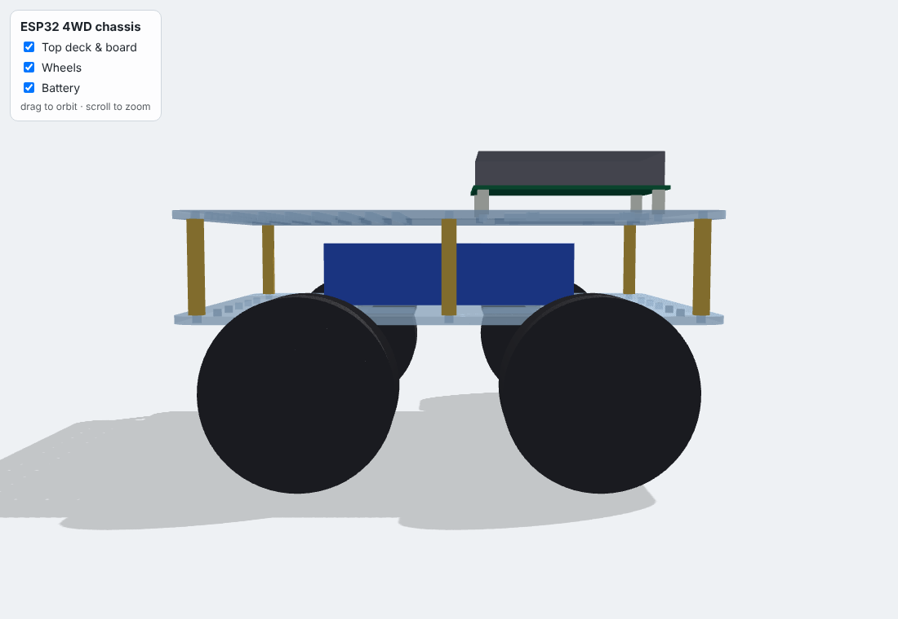

# Acrylic chassis

A two-deck, laser-cut acrylic chassis:

- **Lower deck:** the four JGA25-371 motors hang under it in their L-brackets, and the battery sits on top of it.
- **Upper deck:** the Maker-ESP32 sits at the rear, with a grid of M3 accessory holes at the front.


| | |
|---|---|
| Plates | 2 × 160 × 200 mm, 3 mm acrylic |
| Footprint | 222 mm wide (over tyres) × 200 mm long |
| Wheelbase / track | 100 mm / 196 mm (wheel centres): see [why 100 mm](#why-a-100-mm-wheelbase) |
| Ground clearance | 19 mm (bracket bottoms); 53 mm under the lower deck |
| Deck spacing | 35 mm (fits a 3S 2200 mAh LiPo up to ~28 mm tall) |
| Mass (estimated) | ~1.2 kg, centre of gravity 52 mm above the floor |




## Files

| File | Use |
|---|---|
| `out/bottom_plate.svg` / `.dxf` | Laser cutting, lower deck (SVG for LightBurn) |
| `out/top_plate.svg` / `.dxf` | Laser cutting, upper deck |
| `out/fit_test_coupon.svg` / `.dxf` | **Cut this first.** A small test piece, see below |
| `out/print_template_1to1.pdf` | Print at 100 % to check fit on paper before ordering |
| `out/chassis_assembly.step` | Full 3D assembly for any CAD program |
| `viewer.html` | Interactive 3D view (`python3 -m http.server` in this folder, then open `/viewer.html`) |
| `chassis.py` | Generator for all of the above |

Layers and colours: **CUT = red**, **ENGRAVE = blue** (a forward-pointing
arrow on each plate). Units are millimetres. SVG strokes are 0.01 mm
hairlines, which most laser services expect. Check your service's rules.


## Before ordering: verify the fit (5 minutes)

The bracket hole pattern comes from a published drawing of a JGA25 bracket,
not from your actual bracket, so check it:

1. Print `out/print_template_1to1.pdf` at **100 % / "Actual size"**. Measure
   the 100 mm bar at the bottom. If it isn't exactly 100 mm, your printer
   scaled the page.
2. Lay a bracket flange on one of the four slot groups on the bottom-plate
   page. The bracket's bend (outer face) goes on the plate edge. All four
   flange holes should sit inside the slots.
3. Lay the Maker-ESP32 on the top-plate page. Its four corner holes should
   line up with the four circles near the rear.

If you can, cut `fit_test_coupon` first (it costs pennies):

- **Slots:** check them against a real bracket. The coupon's right edge represents the plate edge.
- **Hole ladder:** pick the hole size (3.0 / 3.2 / 3.4 / 3.6 mm) where an M3 screw slides in freely.
- **40 mm engraved line:** measure it with calipers to confirm the cutter's scale.

If anything is off, edit the parameters at the top of `chassis.py`
(`BRK_HOLE_ROWS`, `BRK_HOLE_SPACING`, `M3_CLEAR`, ...) and regenerate (see
below).

## Cutting with LightBurn

Use the **SVG** files: `File → Import`, or drag them into the workspace. They
import at their true size in mm, and the colours land on LightBurn's default
layers:

| Layer | Colour | Mode | Purpose |
|---|---|---|---|
| 02 | red `#FF0000` | **Line**, full cut | outlines and holes |
| 01 | blue `#0000FF` | **Line**, low power (score) | forward arrows and the coupon's 40 mm line |

- **Cut order:** in `Edit → Settings → Optimization`, keep **"Cut inner
  shapes first"** on (it's the default). The holes are then cut before each
  plate's outline frees it, so nothing shifts mid-job.
- **Laser type matters:**
  - **CO₂ laser:** cuts 3 mm cast acrylic of any colour in one pass.
  - **Diode laser:** a blue diode beam goes straight through **clear and
    light-coloured acrylic** without cutting it. Use **opaque black (or
    another dark, opaque colour)** cast acrylic, expect several passes, and
    use air assist.
- **Settings:** acrylic settings vary from machine to machine, so cut the
  fit-test coupon first. It's small, and it also confirms your scale (the
  40 mm line) and which hole size suits M3 screws.
- **Hole accuracy:** holes come out about one beam-width (the kerf) oversize,
  which suits clearance holes. If the coupon's screws are too loose, either
  pick the next smaller ladder size for `M3_CLEAR`, or set a **kerf offset**
  in the cut layer.
- **Bed size:** each plate needs a 164 × 204 mm area. Both plates fit side by
  side on a 400 × 400 mm bed.
- **Safety:** acrylic burns with a clear flame. Never leave it cutting
  unattended, and keep the extraction running.

The DXF files carry the same geometry (layers `CUT` and `ENGRAVE`) if your
workflow prefers DXF.

## Ordering instead

- Material: **3 mm cast acrylic**. It cuts more cleanly and cracks less around
  screws than extruded acrylic. Clear or any colour.
- Any laser service that accepts DXF or SVG works, as does a makerspace laser.
  Upload the three files and tell them red = cut and blue = engrave (or score).

## Parts list

| Qty | Part | Notes |
|---|---|---|
| 1 | Bottom plate, top plate, fit coupon | 3 mm acrylic |
| 4 | JGA25 L-brackets + motor screws | from the motor kit |
| 16 | M3 × 10 screw + **M3 nylock nut** | brackets to the bottom plate |
| 6 | M3 × 35 hex standoff, female–female | between the decks |
| 12 | M3 × 6 screw | standoff ends |
| 4 | M3 × 10 **nylon** standoff + 8 × M3 × 6 nylon screws | board on the top plate (nylon can't short anything) |
| 2 | 20 mm hook-and-loop strap, ~250 mm | battery |
| ~10 | 3 mm cable ties | wire management |
| 1 | 3S LiPo, ~2200 mAh, ≤ 110 × 50 × 28 mm | or a 12 V pack of similar size |
| 1 | XT60 (or your battery's plug) to 5.5 × 2.1 mm DC barrel lead | power to the board's DC jack |
| 1 | **LiPo voltage alarm (buzzer)** on the balance lead | the board can't measure battery voltage, and an over-discharged LiPo is ruined |

Acrylic cracks if over-tightened. Snug the screws, then stop. Nylon washers
under screw heads help.

## Assembly

1. **Peel** the protective film. Note the engraved arrows: they point **forward**.
2. **Motors into brackets.** Rotate each motor so its **encoder connector (6-pin
   plug) points up**, towards where the plate will be. The wire slots above
   the motors are sized for that orientation.
3. **Brackets under the bottom plate.** The flange goes under the plate,
   pointing inwards, and the bracket face lines up with the plate's side edge.
   Fit an M3 × 10 screw from the top and a nylock nut underneath. Before tightening,
   slide the bracket outward in its slots until the face is flush with the edge.
4. **Wheels:** fit the couplings and wheels onto the shafts.
5. **Wires:** bring each motor's cable up through the slot above its pair of
   motors, then tie it down at the cable-tie holes.
6. **Standoffs:** screw the six M3 × 35 standoffs onto the bottom plate.
7. **Battery:** thread the two straps down through one pair of strap slots and
   up through the other, and strap the battery in the middle.
8. **Board:** fit the nylon standoffs on the top plate and mount the
   Maker-ESP32 with its **USB / DC-jack end toward the rear** (away from the
   arrow).
9. **Top plate:** lower it onto the standoffs, feeding the wires up through
   the two long slots beside the board. Motor wires go to the board's motor
   ports; encoder wires go to the pins in [docs/WIRING.md](../../docs/WIRING.md).
   Screw the top plate down.
10. Continue with bring-up in the [main README](../../README.md#3-bring-up-and-calibration-do-this-once).

## Why a 100 mm wheelbase

A skid-steer robot turns by **scrubbing its tyres sideways**. The longer the
wheelbase, the harder that scrubbing, and the more torque each motor needs to
spin the robot in place. These 1:9.6 / 500 RPM motors are fast but have
little torque (about 0.9 kg·cm at stall), so turning is the limiting factor.
Driving straight needs only a fraction of that.

A shorter wheelbase also has a limit. The robot must not be able to tip over
nose-first when it brakes hard. With the centre of gravity at 52 mm, the
tyres must slide before it tips, which needs `(wheelbase / 2) / CoG height`
above the tyre friction (about 0.8).

`python chassis.py --sweep` computes both from the actual 3D model:

| Wheelbase | L / B | Spin torque per wheel | % of stall | Tip margin | |
|---|---|---|---|---|---|
| 80 mm | 0.41 | 0.32 kg·cm | 35 % | 0.92 | can tip |
| 90 mm | 0.46 | 0.36 kg·cm | 40 % | 1.04 | marginal |
| **100 mm** | **0.51** | **0.40 kg·cm** | **44 %** | **1.16** | **chosen** |
| 110 mm | 0.56 | 0.44 kg·cm | 48 % | 1.28 | ok |
| 130 mm | 0.66 | 0.51 kg·cm | 57 % | 1.52 | turns sluggishly |

How to read it:

- **L / B** is the wheelbase divided by the track. Below about 0.6 is good for
  skid steer, and it must be below 1 or the robot can't turn on the spot at all.
- **Tip margin** is how much harder it would have to brake to tip than to skid.
  Above 1.0 means it skids first, so it can't tip on a flat floor.

The torque figures use the motor listing's 24 V table and tyre friction 0.8
(smooth floor), so treat them as estimates. On carpet the tyres grip less
sideways and turning gets easier. To see the real load, watch the driving
page's wheel readouts while spinning in place: each shows the motor's duty
(%). If a motor sits near 100 % when turning on your floor, these assumptions
don't hold for your surface. The fix is then a higher-torque gear ratio of the
same motor (e.g. 1:21.3, ~280 RPM), which drops straight into this chassis.

## Changing the design

```sh
cd hardware/chassis
python3 -m venv .venv && . .venv/bin/activate
pip install -r requirements.txt
python chassis.py
```

All dimensions are parameters at the top of `chassis.py`: plate size,
wheelbase, deck spacing, acrylic thickness, battery size, board position,
hole sizes, bracket pattern. The part masses and physics assumptions are
there too. Run `python chassis.py --sweep` to re-evaluate the wheelbase after
changing them.

Every run rebuilds the 3D assembly and **refuses to write files if the
design is broken**:

- any two parts collide (motors, encoder plugs, bracket nuts, wheels, battery,
  battery straps, standoffs, board)
- spinning in place would need more than half the motors' stall torque
- the robot could tip over under hard braking
- ground clearance is too low
- a hole is within 2 mm of an edge or of another hole
- an engraving runs over a cut-out
- there's no room behind the motors for their wires
