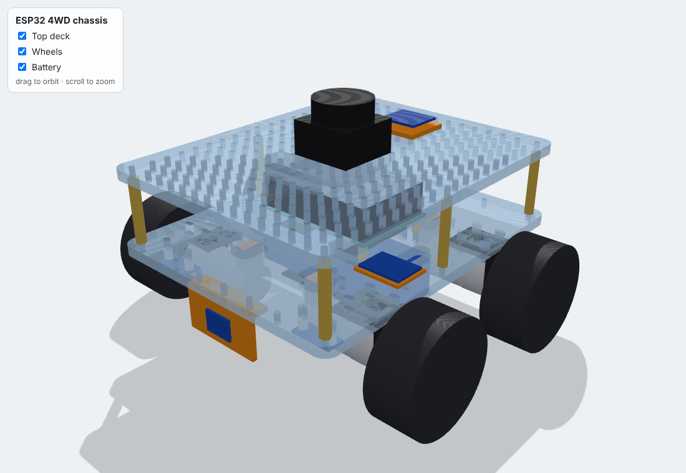
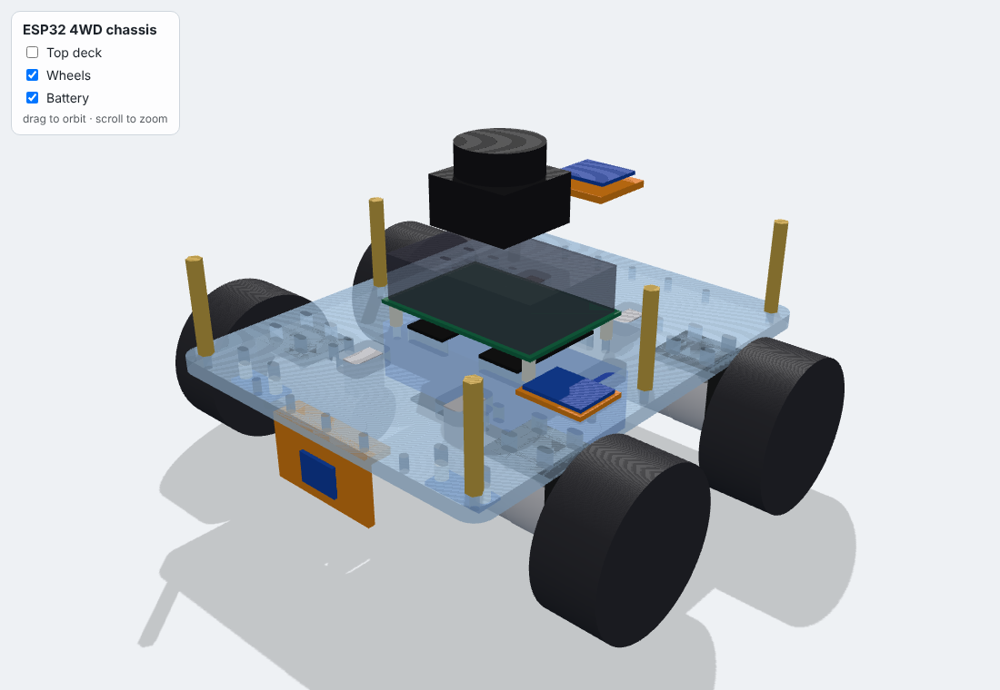
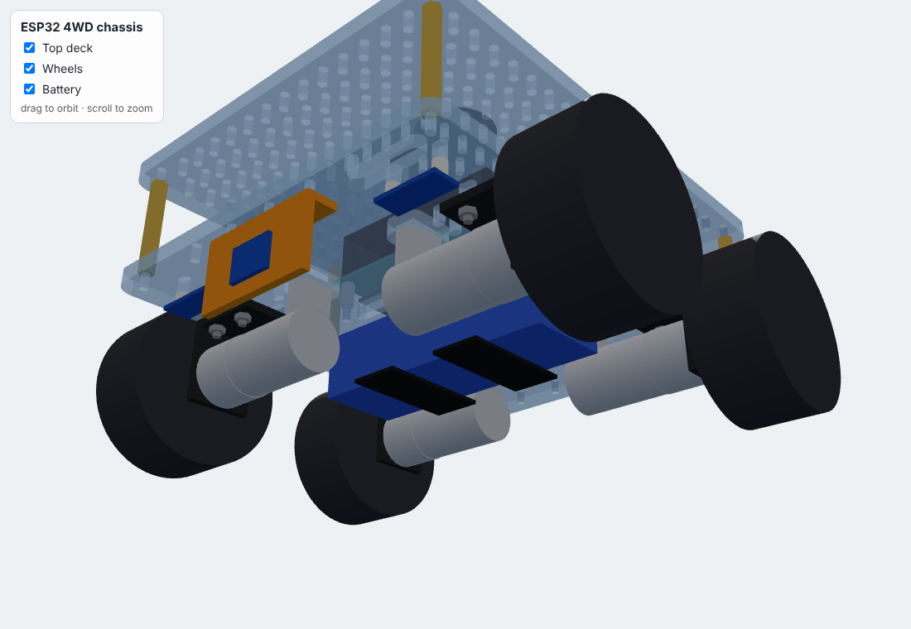
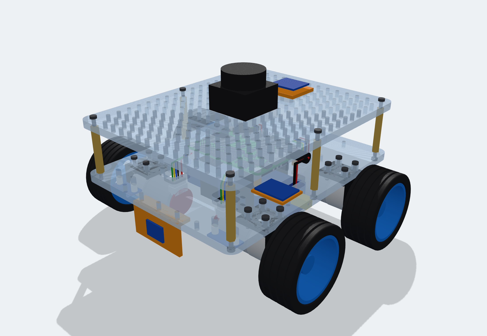
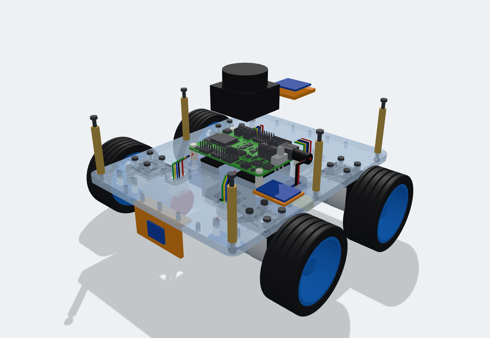
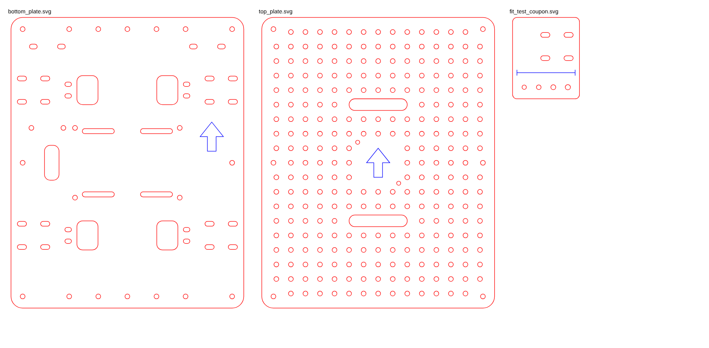

# Acrylic chassis

A two-deck, laser-cut acrylic chassis:

- **Lower deck:** the four JGA25-371 motors hang under it in their L-brackets.
  The **Maker-ESP32 sits on top of it, right between the motors**, so every
  motor and encoder cable comes straight up through a slot beside the board,
  a few centimetres instead of a trip to another deck. The battery hangs
  **underneath** it between the axles, which keeps the centre of gravity low.
- **Upper deck:** a full grid of M3 holes for sensors and add-ons. It also
  protects the board.



| | |
|---|---|
| Plates | 2 × 160 × 200 mm, 1/4" (6.35 mm) cast acrylic |
| Footprint | 228 mm wide (over tyres) × 200 mm long |
| Wheelbase / track | 100 mm / 200.5 mm (wheel centres): see [why 100 mm](#why-a-100-mm-wheelbase) |
| Ground clearance | 20 mm (bracket bottoms), 25 mm under the battery and front ToF bracket |
| Deck spacing | 40 mm (board plus plugged-in wires, with room to spare) |
| Battery | 3S LiPo up to ~110 × 34 × 26 mm, strapped under the lower deck |
| Mass (estimated) | ~1.54 kg with the sensors, centre of gravity 55 mm above the floor |


Top deck removed (the controller sits between the motor wire slots):



From below (battery strapped between the axles):



## Full detailed model (for CAD programs)

`full_model.py` builds the complete robot as real solid parts:

- the plates with all their holes
- brackets, motors (gearbox, D-shaft, encoder board, plug and wires)
- treaded wheels with spoked rims and hex couplings
- brass standoffs, every screw and nut
- the battery with its straps and lead
- NULLLAB's own 3D model of the Maker-ESP32, with every component

All positions come from `chassis.py`, so the two models always agree. The
script also checks the real board model against the plates, straps and
wiring.





| File | Open it with |
|---|---|
| `out/robot_full.step` | Any CAD program (SolidWorks, Fusion 360, Onshape, FreeCAD, Shapr3D...). Solid bodies, one named and coloured part each. **Try this first.** |
| `out/robot_full.stl` | Anything that only takes meshes: 3D viewers, slicers, simpler modelling apps |
| `out/robot_full.glb` | `viewer.html?model=robot_full` in a browser |

These files are about 50 MB, so they aren't committed. Either download them
from the latest CI run (the **robot-full-model** artifact on the Actions tab),
or build them yourself:

```sh
cd hardware/chassis
python full_model.py      # downloads the board model from NULLLAB's GitHub the first time
```

## Files

| File | Use |
|---|---|
| `out/bottom_plate.svg` / `.dxf` | Laser cutting, lower deck (SVG for LightBurn) |
| `out/top_plate.svg` / `.dxf` | Laser cutting, upper deck |
| `out/fit_test_coupon.svg` / `.dxf` | **Cut this first.** A small test piece, see below |
| `out/chassis_plates.lbrn2`, `out/fit_test_coupon.lbrn2` | **LightBurn projects** with the layers set up (power and speed are placeholders) |
| `out/cut_sheet_both_plates.svg` | Both plates laid out together for one LightBurn job (needs 330 × 204 mm of material) |
| `out/size_check_24x36.pdf` | **24 × 36 in sheet for a 24-inch plotter:** both plates and the coupon at 1:1 with outlines of the real parts, X and Y scale bars, renders and a checklist (`size_check_poster.py`) |
| `out/print_template_1to1.pdf` | The same plates on Letter/A4 pages, one per page |
| `out/chassis_assembly.step` | Full 3D assembly for any CAD program |
| `viewer.html` | Interactive 3D view (`python3 -m http.server` in this folder, then open `/viewer.html`) |
| `chassis.py` | Generator for all of the above |

Layers and colours: **CUT = red**, **ENGRAVE = blue** (a forward-pointing
arrow on each plate). Units are millimetres. SVG strokes are 0.01 mm
hairlines, which most laser services expect. Check your service's rules.



## Before ordering: verify the fit (5 minutes)

The bracket hole pattern comes from the bracket's listing: a 16 mm square of
M3 holes, centred on a 31 mm flange. This is the correction made in the
SolidCraft model (`adamivie/jetson-ugv-chassis`, `esp32_bot`). An earlier
TechMakers drawing put the rows 14 mm apart, and plates cut before this
change won't fit. Neither source is your actual bracket, so check it:

1. Print `out/size_check_24x36.pdf` on the 24-inch plotter (or
   `out/print_template_1to1.pdf` on Letter/A4) at **100 % / "Actual size"**.
   Measure the scale bars. If they aren't exact, the printer scaled the page.
2. Lay a bracket flange on one of the four slot groups on the bottom-plate
   page. The bracket's bend (outer face) goes on the plate edge. All four
   flange holes should sit inside the slots.
3. Lay the Maker-ESP32 on the bottom-plate page. Its four corner holes should
   line up with the four circles in the middle.

If you can, cut `fit_test_coupon` first (it costs pennies):

- **Slots:** check them against a real bracket. The coupon's right edge represents the plate edge.
- **Hole ladder:** pick the hole size (3.0 / 3.2 / 3.4 / 3.6 mm) where an M3 screw slides in freely.
- **40 mm engraved line:** measure it with calipers to confirm the cutter's scale.

If anything is off, edit the parameters at the top of `chassis.py`
(`BRK_HOLE_ROWS`, `BRK_HOLE_SPACING`, `M3_CLEAR`, ...) and regenerate (see
below).

## Cut day checklist

1. **Print check:** print `out/size_check_24x36.pdf` (24-inch plotter) or
   `out/print_template_1to1.pdf` (Letter/A4) at 100 %. Confirm the scale bars,
   then lay a bracket, the Maker-ESP32 and any sensors on their outlines.
2. **Coupon:** cut `out/fit_test_coupon.svg`. Check that the bracket fits the
   slots, choose the hole size where an M3 screw slides in freely, and measure
   the 40 mm line.
3. **Adjust if needed:** if anything was off, change the parameter in
   `chassis.py`, regenerate, and repeat step 2.
4. **Plates:** cut `out/cut_sheet_both_plates.svg` (or the two plate files
   one at a time). Use 1/4" (6.35 mm) cast acrylic, at least 330 × 204 mm with a margin.

## Cutting with LightBurn

**Easiest: open the LightBurn projects.** `out/chassis_plates.lbrn2` has both
plates and `out/fit_test_coupon.lbrn2` has the coupon. Their layers are already
set up (02 red = cut, runs second; 01 blue = score, runs first), the material
height is 6.35 mm, and every hole and slot is a native circle or rounded
rectangle you can select. The power and speed in them are **placeholders**
(90 % at 6 mm/s for a 40-60 W CO₂ laser): run a material test on your sheet and
set them before cutting.

Or use the **SVG** files: `File → Import`, or drag them into the workspace. They
import at their true size in mm, and the colours land on LightBurn's default
layers:

| Layer | Colour | Mode | Purpose |
|---|---|---|---|
| 02 | red `#FF0000` | **Line**, full cut | outlines and holes |
| 01 | blue `#0000FF` | **Line**, low power (score) | forward arrows and the coupon's 40 mm line |

- **Cut order:** in `Edit → Settings → Optimization`, keep **"Cut inner
  shapes first"** on (it's the default). The holes are then cut before each
  plate's outline frees it, so nothing shifts mid-job.
- **Laser type matters:** 1/4" acrylic needs a **CO₂ laser**, typically 40 W
  or more, slow and at high power, sometimes in two passes. A diode laser
  can't cut 6.35 mm acrylic, and can't cut clear acrylic at any thickness
  (the beam passes straight through).
- **Settings:** acrylic settings vary from machine to machine, so cut the
  fit-test coupon first. It's small, and it also confirms your scale (the
  40 mm line) and which hole size suits M3 screws.
- **Hole accuracy:** holes come out about one beam-width (the kerf) oversize,
  which suits clearance holes. If the coupon's screws are too loose, either
  pick the next smaller ladder size for `M3_CLEAR`, or set a **kerf offset**
  in the cut layer.
- **Bed size:** each plate needs a 164 × 204 mm area. Both plates fit side by
  side on a 400 × 400 mm bed.
- **Safety:** acrylic burns with a clear flame. Never leave it cutting
  unattended, and keep the extraction running.

The DXF files carry the same geometry (layers `CUT` and `ENGRAVE`) if your
workflow prefers DXF.

## Ordering instead

- Material: **1/4" (6.35 mm) cast acrylic**. It cuts more cleanly and cracks
  less around screws than extruded acrylic. Clear or any colour.
- Any laser service that accepts DXF or SVG works, as does a makerspace laser.
  Upload the three files and tell them red = cut and blue = engrave (or score).

## Parts list

| Qty | Part | Notes |
|---|---|---|
| 1 | Bottom plate, top plate, fit coupon | 1/4" (6.35 mm) acrylic |
| 4 | JGA25 L-brackets + motor screws | from the motor kit |
| 16 | **M3 × 14** screw + **M3 nylock nut** | brackets to the bottom plate (through 6.35 mm plate + 3.3 mm flange) |
| 6 | M3 × 40 hex standoff, female–female | between the decks |
| 12 | **M3 × 10** screw | standoff ends (through the 6.35 mm plate) |
| 4 | M3 × 10 **nylon** standoff, 4 × M3 × 6 + 4 × **M3 × 10** nylon screws | board on the lower deck: M3 × 6 through the board, M3 × 10 up through the plate |
| 2 | 20 mm hook-and-loop strap, ~200 mm | battery |
| ~10 | 3 mm cable ties | wire management |
| 1 | 3S LiPo, ~2200 mAh, ≤ 110 × 34 × 26 mm | or a 12 V pack of similar size |
| 1 | XT60 (or your battery's plug) to 5.5 × 2.1 mm DC barrel lead | power to the board's DC jack |
| 1 | **LiPo voltage alarm (buzzer)** on the balance lead | the board can't measure battery voltage, and an over-discharged LiPo is ruined |
| | *Optional sensors (see [Sensor mounts](#sensor-mounts))* | |
| 1 | LD06 lidar + 2 × M2.5 screws | top deck |
| 1 | VL53L5CX board + printed front bracket | front accessory holes |
| 2 | VL53L0X GY-530 module + 4 × M3 × 6 nylon standoffs | under the front corners |
| 1 | BNO085 IMU + printed carrier | top deck grid |
| 1 | INA226 CJMCU-226 + printed carrier | lower deck |

Acrylic cracks if over-tightened. Snug the screws, then stop. Nylon washers
under screw heads help.

## Assembly

1. **Peel** the protective film. Note the engraved arrows: they point **forward**.
2. **Motors into brackets.** Rotate each motor so its **encoder connector (6-pin
   plug) points up**, towards where the plate will be. The wire slots above
   the motors are sized for that orientation.
3. **Brackets under the bottom plate.** The flange goes under the plate,
   pointing inwards, and the bracket face lines up with the plate's side edge.
   Fit an M3 × 14 screw from the top and a nylock nut underneath. Before tightening,
   slide the bracket outward in its slots until the face is flush with the edge.
4. **Wheels:** fit the couplings and wheels onto the shafts.
5. **Battery straps first.** The straps run under the board, so fit them now.
   Thread each strap down through one slot of a pair and up through the other,
   leaving a loop hanging underneath for the battery.
6. **Board:** fit the four nylon standoffs on the bottom plate and mount the
   Maker-ESP32 across the robot, with its **DC-jack end on the left**,
   next to the long slot. The straps pass flat underneath it.
7. **Wires:** bring each motor's cable up through the slot above it, plug it
   in (motor wires to the motor ports, encoder wires to the pins in
   [docs/WIRING.md](../../docs/WIRING.md)), and tie it down at the cable-tie holes.
8. **Battery:** slide it into the strap loops under the robot (lying across
   it), cinch the straps, and bring its lead up through the slot beside the
   DC jack.
9. **Top plate:** screw the six M3 × 40 standoffs onto the bottom plate, then
   the top plate onto them. Sensor wires can come down through its two
   centre slots to the board.
10. Continue with bring-up in the [main README](../../README.md#3-bring-up-and-calibration-do-this-once).

To swap or charge the battery, open the straps underneath; you don't need to
take anything apart.

## Why a 100 mm wheelbase

A skid-steer robot turns by **scrubbing its tyres sideways**. The longer the
wheelbase, the harder that scrubbing, and the more torque each motor needs to
spin the robot in place. These 1:9.6 / 500 RPM motors are fast but have
little torque (about 0.9 kg·cm at stall), so turning is the limiting factor.
Driving straight needs only a fraction of that.

A shorter wheelbase also has a limit. The robot must not be able to tip over
nose-first when it brakes hard. With the centre of gravity at 55 mm, the
tyres must slide before it tips, which needs `(wheelbase / 2) / CoG height`
above the tyre friction (about 0.8).

`python chassis.py --sweep` computes both from the actual 3D model:

| Wheelbase | L / B | Spin torque per wheel | % of stall | Tip margin | |
|---|---|---|---|---|---|
| 80 mm | 0.40 | 0.40 kg·cm | 44 % | 0.88 | can tip |
| 90 mm | 0.45 | 0.45 kg·cm | 50 % | 0.99 | can tip |
| **100 mm** | **0.50** | **0.50 kg·cm** | **55 %** | **1.11** | **chosen** |
| 110 mm | 0.55 | 0.55 kg·cm | 61 % | 1.22 | weak turning |
| 130 mm | 0.65 | 0.65 kg·cm | 72 % | 1.45 | turns sluggishly |

These figures are for 1/4" plates with the sensors fitted: about 1.54 kg,
with the centre of gravity at 55 mm. 100 mm is the only wheelbase that is
both tip-safe and within the turning limit.

**The 1/4" trade-off:** 1/4" plates weigh twice as much as 3 mm ones (about
225 g each), so turning in place takes about 55 % of stall torque, above the
50 % I'd normally aim for. The limit (`TURN_TORQUE_MAX_FRACTION`) was raised
to 60 % for this deliberate choice. The robot turns fine but works its motors
harder in spins, so avoid long spins on grippy floors. The same motor with a
1:21.3 gearbox would roughly halve the load, at about 1 m/s top speed.

How to read it:

- **L / B** is the wheelbase divided by the track. Below about 0.6 is good for
  skid steer, and it must be below 1 or the robot can't turn on the spot at all.
- **Tip margin** is how much harder it would have to brake to tip than to skid.
  Above 1.0 means it skids first, so it can't tip on a flat floor.

The torque figures use the motor listing's 24 V table and tyre friction 0.8
(smooth floor), so treat them as estimates. On carpet the tyres grip less
sideways and turning gets easier. To see the real load, watch the driving
page's wheel readouts while spinning in place: each shows the motor's duty
(%). If a motor sits near 100 % when turning on your floor, these assumptions
don't hold for your surface. The fix is then a higher-torque gear ratio of the
same motor (e.g. 1:21.3, ~280 RPM), which drops straight into this chassis.

## Motor placement

Every placement choice was checked against the model (`python chassis.py
--sweep`, plus the summary printed by every run):

| Choice | Why it's the best option |
|---|---|
| **Axles centred on the centre of gravity** (CoG at 0.0 mm fore/aft and sideways) | Each wheel carries exactly 25 % of the weight. Equal grip on all four means straight tracking and turns that pivot about the middle, with no lightly loaded wheel spinning out |
| **Motors underslung** (brackets under the lower deck) | The motor axle height is fixed by the wheel radius, so mounting them on top would only push the deck down to 9 mm off the floor. Underneath leaves room for the battery below the deck and gives 19 mm ground clearance |
| **Bracket faces flush with the plate sides** | Wheels as close to the body as the couplings allow: the narrowest robot for its track |
| **Motors back-to-back, encoder plugs pointing up** | Plugs sit directly under the wire slots next to the controller: the shortest possible cables |
| **Wheelbase 100 mm** | See [why 100 mm](#why-a-100-mm-wheelbase) |
| **Track 196 mm** | A trade-off, see below |

Sideways roll-over isn't a concern: the roll margin is 2.28 (it would slide
long before it rolled).

**Track width is the one real trade-off.** A wider track makes turning
easier, but the robot gets wider:

| Plate width | Track | Overall width | Spin torque per wheel | % of stall |
|---|---|---|---|---|
| 140 mm | 180 mm | 208 mm | 0.55 kg·cm | 62 % |
| **160 mm** | **200.5 mm** | **228 mm** | **0.50 kg·cm** | **55 %** |
| 180 mm | 220 mm | 248 mm | 0.45 kg·cm | 50 % |
| 200 mm | 240 mm | 268 mm | 0.42 kg·cm | 46 % |

The motors need at least 126 mm of plate width. The returns diminish: each
extra 20 mm of width buys only about 5 % of stall torque. 160 mm keeps the
robot compact. If you'd rather turn more easily and width doesn't matter,
set `PLATE_W = 180` and regenerate; every check re-runs automatically. If
turning really is too hard on your floor, the bigger lever is the motors'
gear ratio (see above), not the chassis.

## Why the battery goes underneath

`BATTERY_MOUNT` in `chassis.py` switches between two layouts:

| | Centre of gravity | Tip margin | Checks |
|---|---|---|---|
| **`"under"` (default):** strapped beneath the lower deck | **55 mm** | **1.11** | pass |
| `"top"`: strapped on the top deck | 65 mm | 0.93 | fail: hits the lidar and IMU, and could tip |

With the sensors fitted, underneath is the only workable place, and it's still
easy to swap the battery from below. (Without sensors, `SENSORS = False`, the
top-deck layout passes too.)

## Sensor mounts

These come from the SolidCraft model (`adamivie/jetson-ugv-chassis`,
`esp32_bot` @ `b0c8823`) and are checked for collisions like everything else.
Set `SENSORS = False` in `chassis.py` to leave their holes out.

| Sensor | Where | New holes in the acrylic |
|---|---|---|
| LD06 360° lidar | Top deck, centre | 2 × M2.5 (2.8 mm) on the diagonal of a 28.2 mm square |
| VL53L5CX 8×8 ToF | Printed L-bracket at the front, below the lower deck | none: uses the front accessory holes at ±20 mm |
| 2 × VL53L0X (GY-530) cliff sensors | Under the front corners on 6 mm standoffs | 2 slots each, 19.3 mm apart, slotted ±1 mm (the spacing came from one seller listing, so check your modules) |
| BNO085 IMU | Printed carrier, rear of the top deck | none: uses top-grid holes at (±10, −60) |
| INA226 (CJMCU-226) power monitor | Printed carrier beside the battery-lead slot | 2 × M3 at (−66, 24) and (−44, 24) |

The printed carriers and brackets are modelled in the SolidCraft file.

## Changing the design

```sh
cd hardware/chassis
python3 -m venv .venv && . .venv/bin/activate
pip install -r requirements.txt
python chassis.py
```

All dimensions are parameters at the top of `chassis.py`: plate size,
wheelbase, deck spacing, acrylic thickness, battery size, board position,
hole sizes, bracket pattern. The part masses and physics assumptions are
there too. Run `python chassis.py --sweep` to re-evaluate the wheelbase after
changing them.

Every run rebuilds the 3D assembly and **refuses to write files if the
design is broken**:

- any two parts collide (motors, encoder plugs, bracket nuts, wheels, battery,
  battery straps, standoffs, board and its plugged-in wires)
- the board would sit over the motor wire slots
- spinning in place would need more than `TURN_TORQUE_MAX_FRACTION` of the motors' stall torque (60 %)
- the robot could tip over under hard braking
- ground clearance is too low
- a hole is within 2 mm of an edge or of another hole
- an engraving runs over a cut-out
- there's no room behind the motors for their wires
